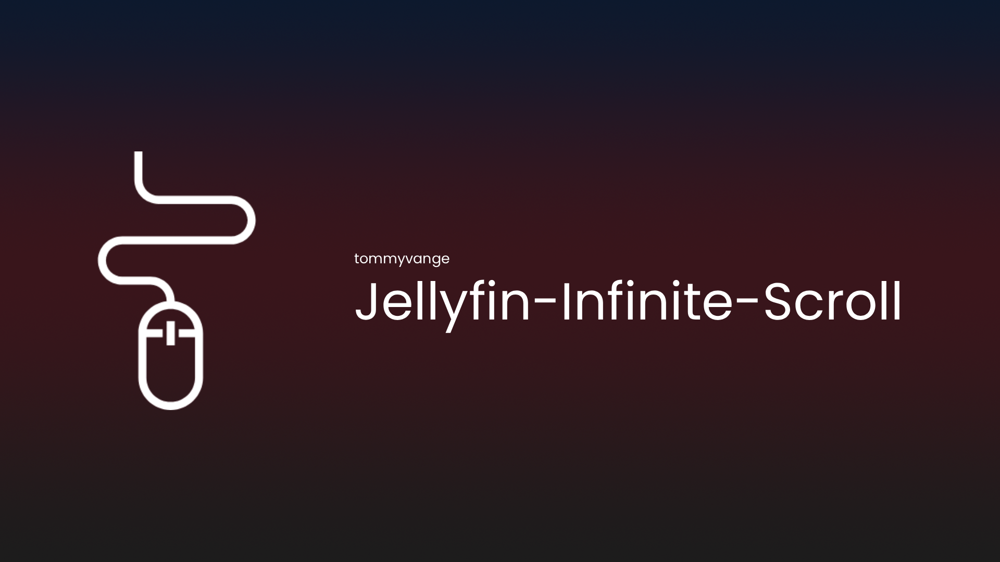

# Jellyfin Infinite Scroll

[](https://github.com/tommyvange/Jellyfin-Infinite-Scroll/actions/workflows/build.yml)
[](https://github.com/tommyvange/Jellyfin-Infinite-Scroll/stargazers)
[](https://github.com/tommyvange/Jellyfin-Infinite-Scroll/releases/latest)
[](LICENSE)

> [!NOTE]
> This plugin only changes the behaviour of the default Jellyfin Web interface, it does not do anything to third party clients.

> [!WARNING]
> This plugin requires IAmParadox27's [File Transformation](https://github.com/IAmParadox27/jellyfin-plugin-file-transformation) plugin.



Replace paging with infinite scrolling in the server-hosted Jellyfin Web client. Scroll toward the bottom of a library to load the next batch into the same list, with Jellyfin's native cards, filters, sorting, selection, and item actions.

The default batch size is **100**, configurable from **1 to 1000**. Loading and completion messages are configurable too.

## Requirements

- **Jellyfin 12.0 or newer**, using .NET 10.
- **File Transformation 3.x**, built for your Jellyfin version.
- The **server-hosted Jellyfin Web client**, in either Modern or Legacy layout.

Native apps and separately hosted web clients render their own interfaces and do not use this plugin's web transformations.

## Install

1. Install **File Transformation 3.x** for your Jellyfin version. Add [IAmParadox27's plugin repository](https://www.iamparadox.dev/jellyfin/plugins/manifest.json) in **Dashboard → Plugins → Repositories**, install **File Transformation**, and restart Jellyfin.
2. Add **Infinite Scroll** as a plugin repository using:

   ```text
   https://raw.githubusercontent.com/tommyvange/Jellyfin-Infinite-Scroll/manifest/manifest.json
   ```

3. Install **Infinite Scroll** from the catalog, restart Jellyfin, and hard-refresh the web client.
4. Open **Dashboard → Plugins → Infinite Scroll**, choose the batch size and status messages, and save. Reload open Jellyfin tabs to apply changes. Settings apply to all users.

File Transformation must be installed separately; Jellyfin does not install it automatically.

For manual installation, download the ZIP from [GitHub Releases](https://github.com/tommyvange/Jellyfin-Infinite-Scroll/releases), stop Jellyfin, and extract all ZIP contents directly into `plugins/Infinite Scroll_<version>/`. The DLL, `meta.json`, and plugin image must be at that directory's root. In the official Docker image, the plugins directory is normally `/config/plugins/`. Preserve the separate plugin configuration when upgrading, then restart Jellyfin and refresh the web client.

**Upgrading an early manual installation:** early packages set `autoUpdate` to `false` in `meta.json`. Adding the catalog does not change that preference. Stop Jellyfin and replace the old DLL and `meta.json` with the current release package, keeping the separate plugin configuration file. Current packages set `autoUpdate` to `true`; Jellyfin's update settings and scheduled task control when updates run.

To disable the plugin, turn it off in its settings and reload the web client. To remove it, uninstall through the dashboard or stop Jellyfin and remove its plugin directory.

## Settings and supported views

The default status messages are **Loading more items…** and **All items loaded.** Enter your own plain text in **Loading more items message** and **All items loaded message**, or leave either setting blank to hide its text. Existing configurations keep the defaults when upgrading.

Supported views include:

- **Modern layout:** Movies, Shows, Episodes, Favorites, Collections, Playlists, Albums, Artists, Album Artists, Songs, Studios/Networks, Books, Authors, Photos, Photo Albums, Videos, Music Videos, Mixed Media, and Folders.
- **Legacy layout:** Movies and Shows, including the Movies controller's Favorites mode and card/list layouts.
- **Category results in both layouts:** Movie genres such as **Movies → Categories → Comedy**, plus music genre, studio, and person results handled by the shared list page.

The toolbar shows the server's total item count while paging controls and page ranges are hidden. The total stays consistent as batches load and updates when filters change.

Category totals use the same MUI Chip markup and public theme classes as the Movies and Shows count. Category batches append new cards and initialize only their images, retaining the existing posters, focus, and scroll position.

Requests load one batch at a time and stop at the server's total. A failed request keeps the loaded items and shows a **Retry** button for the same offset. Filters, sorting, and ordinary refreshes start a new result set. Legacy views preserve scroll position and focus when adding items.

**Random sort retains native paging.** Jellyfin generates a new random order for each request, so offset paging cannot provide a complete, stable random list. Horizontal suggestion and genre preview rows, Live TV, and other unsupported views keep their normal behavior.

Loaded items remain mounted until the library is reset; the plugin does not virtualize the list.

## Troubleshooting

If scrolling does not activate, check that both plugins are loaded and File Transformation matches the server version. Use the server's `/web/` client and clear cached web assets. The server log should include `Infinite Scroll registered its web transformations with File Transformation.`

The plugin discovers supported files in the installed web directory at startup. Restart Jellyfin after replacing web assets. Unsupported assets are left unchanged.

File Transformation edits served assets without changing installed web files. Infinite Scroll registers exact paths for recognized files so unrelated JavaScript pipelines remain available to other plugins. Another plugin transforming the same file still needs compatible integration.

The client script loads from the same origin and preserves a configured server base path. Library requests use Jellyfin's authenticated API client and user permissions.

## Build and test

Requires **.NET 10 SDK**, **Node.js 20+**, and `zip`/`unzip`. There are no npm dependencies to install.

```sh
npm test
npm run test:transformations
npm run test:registration
npm run build
npm run package
```

The package command builds the plugin in Release mode and writes the ZIP and SHA-256 checksum to `artifacts/`. It targets the minimum Jellyfin version in `release/config.json`, currently **12.0.0**. Set `DOTNET=/absolute/path/to/dotnet` if the SDK is not on your PATH.

The DLL embeds the client script and settings page. Jellyfin supplies the server assemblies, so there is no separate frontend build or web deployment.

Tests cover loading, offsets, deduplication, retries, cancellation, stale responses, navigation, status messages, native paging fallbacks, scroll and focus behavior, asset transformations, registration, and release tooling.

To check the official production web assets, also install `ar` and `tar`, then run:

```sh
FIXTURE_DIR=.research/fixtures/latest
bash scripts/fetch-web-fixtures.sh latest "$FIXTURE_DIR"
node scripts/verify-web.mjs "$FIXTURE_DIR"
dotnet run --project tests/Transformations -- "$FIXTURE_DIR"/*.chunk.js
node scripts/verify-web.mjs --syntax "$FIXTURE_DIR"/*.patched.js
node scripts/verify-native-bridge.mjs "$FIXTURE_DIR"
node scripts/verify-category-bridge.mjs "$FIXTURE_DIR"
```

Replace `latest` with an exact version in both the directory and downloader arguments to repeat a particular check. The downloader verifies the official web-only Debian package's SHA-256 and discovers integration chunks by their contents.

GitHub Actions checks the minimum supported version and the latest stable Jellyfin release, compiles against the latest server API, and repeats the checks weekly. Before releasing, also test a running server with both layouts, category results, filters, sorting, returning from item details, playback and selection, a reverse-proxy base path, and recovery from a failed request.

## Releases and deployment

Update the four-part version in `Directory.Build.props`, the three-part version in `package.json`, and the release notes in `release/notes.md`. Commit and push to `main`, wait for **Build and test** to pass, then push a matching version tag, such as `v1.2.3.0`.

GitHub Actions runs the tests and compatibility checks, publishes the ZIP and SHA-256 checksum to GitHub Releases, and updates the Jellyfin catalog on the `manifest` branch. The release package targets the minimum supported Jellyfin version. The catalog retains earlier versions and includes Jellyfin's required MD5 checksum of the published ZIP.

Publishing uses GitHub Actions' built-in token. See [the release guide](docs/releasing.md) for versioning, publication retries, and the compatibility policy.

## License

Licensed under the [GNU General Public License v3.0](LICENSE).
